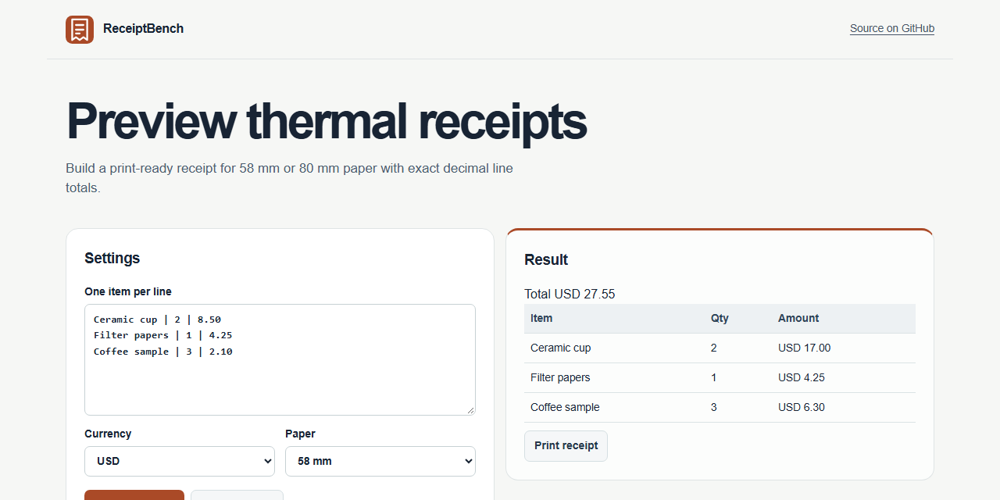

# ReceiptBench

**Preview thermal receipts.** Build a print-ready receipt for 58 mm or 80 mm paper with exact decimal line totals.

[Open the live tool](https://musabukhari237.github.io/receiptbench/) · [Report an issue](https://github.com/MusaBukhari237/receiptbench/issues)

[](https://musabukhari237.github.io/receiptbench/)

## Try an example

Choose Load example and Preview receipt. The total is USD 27.55. Choose the paper width and print from the preview.

## Usage and limits

Receipts use exact integer minor units for prices. Taxes and regulatory invoice fields are outside this preview. In your print dialog choose the matching paper size and disable headers and footers.

## Run locally

Clone this repository, then run:

```sh
python -m http.server 8000 --bind 127.0.0.1 --directory docs
```

Open http://127.0.0.1:8000 in a browser. The site needs no package install. Run `node --test` with Node.js 22 or newer.

## Sponsors

Supported by [LeadCeleris](https://www.leadceleris.com/) and [AIFFICIENTO](https://www.aifficiento.biz/).

## Contributing and license

Use synthetic input in bug reports and contributions. See [contribution notes](CONTRIBUTING.md) and the [MIT license](LICENSE).
